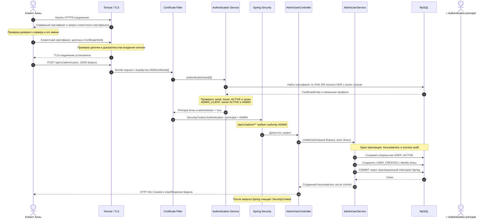

# Как работает административный mTLS endpoint

Пример: Анна, действующий администратор, создаёт обычного пользователя Бориса через
`POST /api/v1/admin/users`. Это описание текущего кода, не будущего enrollment API.

## Что подготовлено заранее

- У клиента Анны есть приватный ключ и соответствующий клиентский сертификат.
  Приватный ключ никогда не отправляется FlowerCA.
- В `certificates` зарегистрирован именно этот сертификат: полный DER, SHA-256 отпечаток,
  serial, issuer, сроки, статус `ACTIVE`, профиль `ADMIN_CLIENT` и ссылка на профиль Анны.
- В `user_profiles` у Анны роль `ADMIN` и статус `ACTIVE`.
- Tomcat имеет отдельные серверные ключ/сертификат и truststore с доверенной клиентской CA.
- Клиент доверяет CA серверного сертификата и проверяет имя сервера.

«Зарегистрированный» означает сохранённый в реестре сертификатов FlowerCA. Обычный путь
выпуска сохраняет сертификат вместе с `CERTIFICATE_ISSUED` в одной транзакции до возврата
успешного результата. Загрузка сертификата из сети не регистрирует его автоматически.
Корректная подпись CA без соответствующей записи в БД не даёт доступ к admin API.

## Последовательность успешного запроса

Схема показывает новое соединение с сертификатной TLS-аутентификацией и валидный запрос.
При повторном HTTP-запросе по уже установленному соединению новый handshake не обязателен,
но наш фильтр снова проверяет зарегистрированный сертификат и полномочия через БД.



TLS и права проверяются в разных слоях. TLS устанавливает криптографически подтверждённое
соединение; FlowerCA связывает предъявленный сертификат с конкретной записью БД и вычисляет
полномочия. Имя CN не предоставляет административных прав.

## Цепочка сертификатов: что находится в элементе 0

Для полной цепочки, выдаваемой нашим Intermediate с Root в issuer chain:

```text
fullChain()[0] = клиентский сертификат Анны
fullChain()[1] = Intermediate CA, подписавший клиентский сертификат
fullChain()[2] = Root CA, подписавший Intermediate
```

В `IssuedCertificate.fullChain()` сначала добавляется leaf, затем issuer chain:

```java
result.add(certificate);
result.addAll(issuerChain);
```

Нельзя обобщать это до «последний сертификат из сети всегда Root». Клиент может передать
только leaf и Intermediate: Root не обязан передаваться по TLS. Порядок начинается с
сертификата отправителя; далее обычно идут его издатели. В цепочке может быть несколько
Intermediate. Tomcat/JDK проверяет путь до заранее доверенного anchor, а не доверяет
Root только потому, что его прислал клиент.

Наш фильтр использует `chain[0]`, а проверку цепочки выполняет TLS-стек до фильтра.
Правила описаны в [TLS 1.3, §4.4.2](https://www.rfc-editor.org/rfc/rfc8446#section-4.4.2).

## FlowerCA identity, principal и Spring SecurityContext

«FlowerCA identity» в этом объяснении — не название отдельного класса. Это установленная
приложением связь «конкретный сертификат → профиль пользователя». Для текущего запроса её
представляет `ClientCertificatePrincipal`:

```java
public record ClientCertificatePrincipal(
    UUID certificateId,
    UUID profileId,
    byte[] certificateFingerprintSha256)
    implements Principal { /* ... */ }
```

В principal нет JPA-сущности Анны, её приватного ключа или поля роли. Полномочие `ADMIN`
передаётся отдельно внутри `Authentication`, после проверок сертификата и владельца.
`CertificateIdentity` — другой тип: одобренные данные для Subject/SAN при выпуске сертификата,
а не контекст вошедшего пользователя.

```text
SecurityContextHolder
└── SecurityContext
    └── Authentication: UsernamePasswordAuthenticationToken
        ├── principal: ClientCertificatePrincipal Анны
        │   ├── profileId: UUID Анны
        │   ├── certificateId: UUID предъявленного сертификата
        │   └── certificateFingerprintSha256: его отпечаток
        ├── authorities: [ADMIN]
        └── credentials: null
```

`UsernamePasswordAuthenticationToken` — стандартная реализация интерфейса `Authentication`,
не сам контекст и не JWT. В нашей реализации она представляет уже аутентифицированного
клиента, а не запускает парольную проверку:

```java
var authentication = UsernamePasswordAuthenticationToken.authenticated(
    result.principal(), null, authorities);
SecurityContextHolder.getContext().setAuthentication(authentication);
```

Spring затем получает тот же principal для аргумента контроллера:

```java
@AuthenticationPrincipal ClientCertificatePrincipal actor
```

Анна — actor, Борис — создаваемый target. `actor` не выбирается из JSON запроса.
В audit сохраняются UUID профиля Анны, UUID её сертификата и его отпечаток, а target ID
указывает на нового Бориса. Сам контекст запроса в БД не сохраняется.

API использует `STATELESS`: identity не переносится в следующий запрос через HTTP-сессию.
В обычной servlet-обработке контекст доступен в потоке запроса и очищается Spring после
обработки; перенос в произвольные фоновые потоки не происходит автоматически.
См. [архитектуру аутентификации Spring Security](https://docs.spring.io/spring-security/reference/servlet/authentication/architecture.html).

## Где запрос может остановиться

| Условие | Результат для admin API |
| --- | --- |
| Предъявленная цепочка не доверена или клиент не владеет соответствующим ключом | TLS-ошибка, без HTTP-ответа |
| Клиент не передал сертификат (`client-auth=want`) | TLS допускает соединение, приложение отвечает 401 |
| Сертификат доверен, но не зарегистрирован в БД или непригоден по проверкам сервиса | 401 |
| Сертификат зарегистрирован и пригоден, но нет административных полномочий | 403 |
| Реестр сертификатов недоступен при аутентификации | 503 |
| Identity администратора подтверждена, данные запроса невалидны | 400 |
| Email создаваемого пользователя уже занят | 409 |
| Пользователь и audit успешно закоммичены | 201 |

Не каждый сертификат, отклонённый приложением, дойдёт до него: например, истёкший сертификат
может быть отклонён ещё TLS-стеком. Проверка сроков в БД остаётся отдельным условием.

Публичный `/api/v1/public/probe` не требует административных полномочий и не обращается
к реестру сертификатов через наш фильтр. Однако проверка TLS предъявленного сертификата
не отключается даже для публичного маршрута.

## Границы текущей реализации

- `POST /api/v1/admin/users` создаёт только профиль USER / ACTIVE, без выдачи сертификата.
- На HTTP-пути `AdminUserService` защищён правилами Spring Security по URL. В самом методе
  `createUser()` пока нет `@PreAuthorize`; прямой Java-вызов не защищён URL-правилом.
- Продление в `AdminCertificateService` дополнительно имеет `@PreAuthorize` и повторную
  проверку заблокированных для обновления записей владельца/сертификата.
- Диаграмма описывает прямой HTTPS на Tomcat, не TLS termination на внешнем reverse proxy.
- Регулярные транспортные тесты сейчас проверяют только TLS 1.3; приложение также включает 1.2.

## Где читать код

- [TLS-конфигурация](../src/main/resources/application-mtls.yaml).
- [Извлечение сертификата и установка Authentication](../src/main/java/com/fidd/flowerca/security/ClientCertificateAuthenticationFilter.java).
- [Проверка сертификата и владельца в БД](../src/main/java/com/fidd/flowerca/security/ClientCertificateAuthenticationService.java).
- [Правила доступа по URL](../src/main/java/com/fidd/flowerca/security/SecurityConfiguration.java).
- [Контроллер и получение actor](../src/main/java/com/fidd/flowerca/api/admin/AdminUserController.java).
- [Создание пользователя и аудит](../src/main/java/com/fidd/flowerca/api/admin/AdminUserService.java).
- [Инструкция по запуску и API](admin-mtls-api.md).
